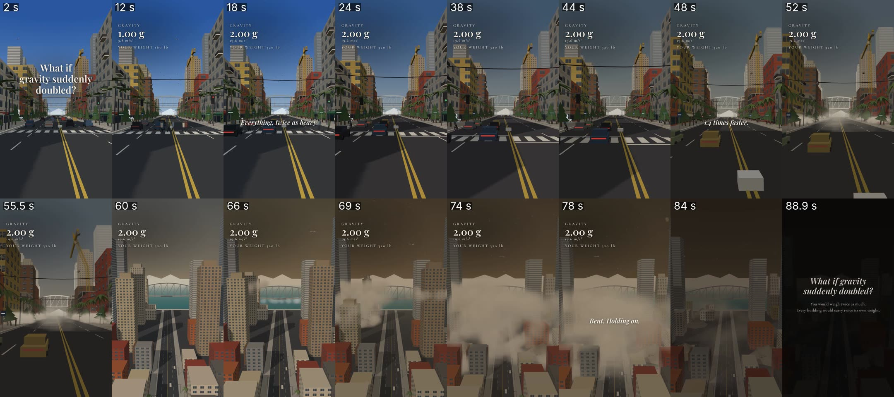

# Gravity-video – alles bij elkaar

**What if gravity suddenly doubled?** Hoe de video is opgebouwd, hoe hij in elkaar is gezet, en hoe je op dezelfde
manier een nieuwe what if maakt met een ander scenario en een andere plek.

- **YouTube:** https://youtu.be/DE61_VUIuCw (openbaar, sinds 4 okt 2026)
- **Video:** `gravity-doubled.mp4` (1080x1920, 90 s), Short in gravity-stijl (stijl B)
- **Bron:** repo `vox-lux`, branch `claude/whatif-gravity-doubled`, map `whatif-demo/gravity-doubled/`
- De eigenaar gebruikt deze video als **voorbeeld voor het verhaal en de stem** van alle IfScape3D-video's.
  Zie `vox-lux` → `whatif-demo/regels/standaard-video.md` op branch `claude/whatif-machine`.

**Inhoud**
1. Wat staat er in deze map
2. Deel 1 – De opbouw van de video (seconde voor seconde)
3. Deel 2 – Hoe hij in elkaar is gezet
4. Deel 3 – Een nieuwe what if op dezelfde manier

## Wat staat er in deze map

| Bestand | Wat het is |
|---|---|
| `gravity-doubled.mp4` | de video zoals hij op YouTube staat |
| `script.txt` | de tekst van de stem, met `[pause]` (0,5 s) en `[long pause]` (1 s) |
| `voice.mp3` | de stem (xAI Lux, tempo 0.9, elke zin apart ingesproken met vaste pauzes) |
| `voice-times.tsv` | begin- en eindtijd van elke zin in `voice.mp3` |
| `scene.html` | de hele 3D-scène (three.js): straat, mensen, auto's, kraan, brug, torens, tekst in beeld |
| `render.mjs` | maakt stilstaande beelden, de thumbnail, `timeline.json` en de video zonder geluid |
| `make_audio.py` | maakt al het geluid (zelf, van ruis) en mixt het met de stem → `mix.wav` |
| `timeline.json` | de tijdlijn (TL) + alles wat valt of breekt; `make_audio.py` maakt hiermee het geluid |
| `thumbnail.jpg` | eerste beeld met de titel |
| `upload.json` | titel en YouTube-link |
| `OVERZICHT.jpg` | 16 beelden uit de video op een rij |
| `ENGINE.txt` | de commit in `vox-lux` waarmee hij gemaakt is |

---

# Deel 1 – De opbouw van de video

Alles hieronder komt uit `scene.html` (beeld), `timeline.json` (tijdlijn), `voice-times.tsv` (stem) en
`make_audio.py` in `vox-lux` (geluid). Tijden zijn **videoseconden**: de stem begint op 0,5 s, dus
videotijd = tijd in `voice-times.tsv` + 0,5.



## In het kort

| | |
|---|---|
| Lengte | 90 s, staand 1080x1920, 30 beelden/s |
| Delen | 3 shots met harde overgangen: **straat** (0–46,4 s), **dichterbij in de straat** (46,4–57,3 s), **hoog boven de stad** (57,3–90 s) |
| Het moment | op **15,9 s** springt de zwaartekracht in 1 seconde van 1 g naar 2 g |
| Hoogtepunt | 64–73 s: vier oude torens storten in, met ± 5 s zonder stem |
| Einde | stof zakt, laatste zin, eindkaart (86 s), uitfaden naar zwart (88,6–90 s) |
| Tekst in beeld | titel (0–9 s), teller linksboven (9,2–80 s), 4 korte zinnen (captions) |
| Stem | 28 zinnen, xAI Lux, tempo 0.9, elke zin apart, vaste pauzes |
| Geluid | alles zelf gemaakt van ruis (geen opnames), stem staat voorop |

## Tijdlijn seconde voor seconde

| Tijd (s) | Stem | Beeld | Tekst in beeld | Geluid |
|---|---|---|---|---|
| 0–9 | "Imagine… in a single second, gravity doubles. Everything on Earth becomes twice as heavy." | Shot 1: ooghoogte (3,2 m) midden op een brede laan met palmen, winkels en verkeer; de camera schuift heel langzaam naar voren. Vanaf 3 s staat het licht op rood en steken 7 mensen over bij het zebrapad. | Titel groot in het midden: *What if gravity suddenly doubled?* (weg op 9 s) | stadsgeluid, auto's die langsrijden, getik van het voetgangerslicht, ver vliegtuig |
| 9–15,6 | "You are standing on a busy street." / "Gravity pulls on you at nine point eight meters per second squared." | Normaal leven: mensen lopen, fietser fietst, vogels cirkelen, vliegtuig hoog in de lucht, fontein spuit. | Teller verschijnt (9,2 s): GRAVITY **1.00 g**, 9.8 m/s², YOUR WEIGHT 160 lb | stad |
| **15,9** | (stilte vóór de volgende zin) | **De klap.** Teller loopt in 1 s naar 2.00 g. Camera zakt een stukje en veert na. Auto's veren door en remmen, palmen en bomen buigen en veren, vogels gaan omlaag, vliegtuig zakt, fontein spuit half zo hoog. Mensen lopen trager en blijven staan. | 2.00 g, 19.6 m/s², 320 lb | grote dreun; daarna klinkt alles dof (oren dicht); gekraak en metaal |
| 16,6–20,2 | "Now, it is nineteen point six." | idem | caption: *Everything, twice as heavy.* | dof |
| 20,6–22,2 | "Your ears pop." | | | ploppend oor: het geluid wordt weer helder |
| 22,7–26,2 | "The air at the ground would press down almost twice as hard." | lucht wordt waziger (meer nevel) | | lage drukdreun eronder |
| 26,7–36,2 | gewicht 160 → 320 pond / "Your heart would have to pump blood…" | mensen lopen gebogen, stoppen | | gekraak van veren en takken |
| 36,7–38,8 | "People stop. Some sit down." | mensen gaan zitten, leunen tegen een muur of blijven gebogen staan; fietser zet zijn voet neer | | |
| 39,8–45,4 | "Cars sink on their springs. Tires flatten. Trees bend toward the ground." | banden worden plat (40 s), bomen buigen verder door (43,5 s), stroomdraden boven de straat zakken | | gesis van banden, kraken van bomen |
| **46,4** | "Anything that falls would hit the ground about one point four times faster." | **Shot 2:** dichter bij de bouwplaats, stof hangt laag. Zonneschermen scheuren af, stukken gevel en dakrand vallen, lantaarnpalen en borden knikken, een stroomkabel knapt (49,3 s). | caption: *1.4 times faster.* | klappen van vallende stukken (berekend), metaal, kabel die knapt, gerommel begint |
| 51–52,3 | "Balconies break off." | 8 balkons breken af en vallen recht naar beneden | | gekraak + klappen + puin |
| 52,6–54,5 | "Windows crack in their frames." | ramen krijgen barsten, 200 glasscherven vallen | | glasgerinkel in 9 golfjes |
| 54,8–56,5 | "A crane folds in half." | de gele bouwkraan (58 m) knikt op 36 m hoogte en klapt dubbel | | metaalgekraak, grote klap + puin |
| **57,3** | "Buildings are designed with a safety margin. But very few were built to carry twice their own weight." | **Shot 3:** hoog boven de stad (100 m), kijkend over de laan naar de baai met een boogbrug; camera drijft langzaam vooruit. De middenoverspanning van de brug zakt 15 m door (58–63 s). | caption: *Not built for twice their weight.* | brug: diep metaal en kraken |
| 64–68 | "The older towers give up first." / "One floor onto the next." | 4 oude torens storten recht in, verdieping op verdieping (64,3 / 66,5 / 68,3 / 69,9 s); stofwolk rolt over de stad; vliegtuig zakt en vecht terug (65,5–72,5 s); lucht kleurt bruin | | lang laag gerommel, een klap per verdieping, zware klap op de grond; camera schudt alleen hier |
| 68–72,9 | **stilte** (4 × lange pauze, ± 5 s) | torens 3 en 4 vallen, stof overal | | alleen het instorten |
| 72,9–75,7 | "Then, the dust begins to settle." | stof wordt dunner | | al het geluid zakt weg (− 93 %): verre wind, lage toon, wat los puin |
| 76,2–80,3 | "Much of the city is still standing. Bent. Holding on." | de stad staat er nog, met stompen waar de torens stonden | caption: *Bent. Holding on.*; teller weg (80 s) | stil |
| 81,3–85,7 | "But from now on, every step you take would carry twice your weight." | beeld wordt donkerder (81 s) | | stil |
| 86–90 | – | eindkaart, op 88,6 s uitfaden naar zwart | *What if gravity suddenly doubled?* + "You would weigh twice as much. Every building would carry twice its own weight." | uitfaden |

## Wat er in de 3D-scène zit (`scene.html`)

Alles is gebouwd uit simpele blokken en kegels (low-poly), met vlakke kleuren en zachte schaduwen. Geen modellen van buiten.

- **Straat:** laan van 20 m breed, 4 rijstroken, dubbele gele middenstreep, stoepen, zebrapad, 2 verkeerslichten.
- **Gebouwen langs de straat:** winkels op de begane grond (gekleurde zonneschermen), 3–9 verdiepingen met ramen, balkons,
  zijstraten, een tweede rij erachter. Eén bouwplaats met open verdiepingen en een **gele torenkraan**.
- **Skyline:** 16 torens (86–182 m) + 140 lage blokken. 4 torens zijn "oud" (zandkleur) en storten in: ze zijn opgebouwd
  uit plakken van 3,5 m. Op ± 2/3 hoogte geeft een verdieping het op, het blok erboven valt recht naar beneden en er
  blijft een stomp van 2 verdiepingen + een puinhoop over.
- **Achtergrond:** baai met blauwgroen water, een boulevard, een boogbrug van 300 m en heuvels aan de overkant.
- **Straatdingen:** palmen en kegelboompjes (buigen en veren), lantaarnpalen en borden (kunnen knikken),
  5 stroomdraden over de straat (zakken; één knapt), fontein (spuit half zo hoog bij 2 g).
- **Leven:** 33 poppetjes (26 lopers, 7 overstekers) die stoppen en gaan zitten, leunen of gebogen staan;
  1 fietser; 16 auto's (4 rijstroken, stoppen voor rood, houden afstand, remmen bij de klap); 8 vogels; 1 vliegtuig.
  Geen geweld: niemand raakt gewond, er wordt niemand geraakt.
- **Natuurkunde:** alles wat valt (34 stukken gevel, 200 glasscherven, zonneschermen, 8 balkons) wordt echt
  doorgerekend met de zwaartekracht van de teller (4 stapjes per beeld). Elke klap op de grond wordt een
  "gebeurtenis" in `timeline.json`, en daar komt later precies op dat moment een geluid.
- **Licht en lucht:** de lucht gaat van helder blauw (begin) via grijs naar stoffig bruin (70–80 s). De nevel wordt
  dikker en het zonlicht zwakker naarmate er meer kapotgaat.
- **Camera:** per shot één rustige, rechte beweging (geen draaien). Bij de klap zakt de camera 22 cm en veert na.
  Schudden alleen bij de grootste klappen (instorten, kraan, de klap zelf).

## Tekst in beeld

Gemaakt in 720x1280 en daarna 1,5× groter gemaakt naar 1080x1920.

| Wat | Waar | Letter |
|---|---|---|
| Titel (0–9 s) | midden, 400 px van boven | Playfair Display 600, 62 px, met zachte schaduw |
| Teller (9,2–80 s) | linksboven (40 px van links, 150 px van boven) | label GRAVITY in Cormorant Garamond 24 px met brede letterafstand; getal **2.00 g** in Playfair 64 px; daaronder m/s² en YOUR WEIGHT … lb |
| Captions | midden, 760 px van boven | Playfair 600 cursief, 42 px, faden in en uit (0,6 s) |
| Eindkaart (86 s) | midden | titel Playfair cursief 54 px + 2 regels Cormorant 27 px |

## Geluid (`make_audio.py`, deel `build_gravity`)

Alles is gemaakt van gefilterde ruis, dus gratis en zonder auteursrecht. Lagen:

1. **Straat:** stadsgeluid (− 15 dB, na de klap − 25 dB), 4 auto's die langsrijden, getik van het voetgangerslicht, ver vliegtuig.
2. **De klap (15,9 s):** grote dreun. Daarna wordt alles **dof** (alsof je oren dichtzitten) tot de oorplop op 20,6 s.
   Lage drukdreun eronder.
3. **Kraken:** 12 kraakjes (veren, takken, gebouwen) tussen de klap en shot 2, gesis van platte banden, kraken van bomen.
4. **Escalatie:** gerommel vanaf shot 2. Voor elke gebeurtenis uit de simulatie een eigen geluid: klap (vallende stukken, links/rechts
   op de plek waar het valt), metaal (zonneschermen, palen), kabel die knapt, glas (9 golfjes), kraan (metaal + grote klap + puin),
   brug (laag metaal + kraken), torens (lang laag gerommel + een klap per verdieping + zware klap op de grond), vliegtuig.
5. **Na het hoogtepunt (72,9 s):** alles zakt 93 % weg; verre wind, lage toon en een paar stukjes puin. Op het eind uitfaden.
6. **Mix:** de stem gaat voor. Het geluid wordt ± 8 dB zachter zodra er gepraat wordt (sidechain), daarna op − 14 LUFS
   (YouTube-niveau), piek − 1 dB.

---

# Deel 2 – Hoe hij in elkaar is gezet

## Hoe het in elkaar is gezet

```
script.txt ──► stem (per zin) ──► voice.mp3 + voice-times.tsv
                                        │
                                        ▼
              TL-blok bovenaan scene.html (tijden = stem + 0,5 s)
                                        │
          ┌─────────────────────────────┼──────────────────────────────┐
          ▼                             ▼                              ▼
 node render.mjs stills        node render.mjs timeline      node render.mjs video silent.mp4 3
 (testbeelden)                 → timeline.json               (720x1280, 30 fps, 3 browsers tegelijk)
                                        │                              │
                                        ▼                              │
                     python3 make_audio.py gravity-doubled             │
                     → sfx-bed.wav + mix.wav (stem + geluid)           │
                                        └──────────────┬───────────────┘
                                                       ▼
                         ffmpeg: beeld 1080x1920 + mix.wav → gravity-doubled.mp4
```

- **Beeld:** `render.mjs` opent `scene.html` in een onzichtbare Chromium-browser (Playwright). Voor elk beeld roept hij
  `renderAt(t)` aan, maakt een screenshot (JPEG) en stuurt die naar ffmpeg (x264, crf 17). Het werk wordt verdeeld over
  3 browsers; de stukken worden daarna aan elkaar geplakt.
- **Alles staat vast:** de scène gebruikt vaste "toevalsgetallen" (seeds) en de natuurkunde wordt vooraf voor alle
  beelden uitgerekend. Elke render geeft dus precies hetzelfde beeld.
- **Eindbestand:** H.264 1080x1920, 30 fps, ± 2,5 Mbit/s; geluid AAC 192 kbit/s stereo, 44,1 kHz; 31 MB.

## Zo is hij gemaakt (stap voor stap)

Alles is gratis behalve de stem. Er is geen AI-beeld gebruikt: alles is zelf gebouwd in 3D.

1. **Verhaal** (`script.txt`). Opbouw:
   1. "Imagine… in a single second, gravity doubles." + wat dat betekent
   2. Waar je bent: "You are standing on a busy street."
   3. Gewoon getal → nieuw getal: 9,8 → 19,6 m/s² (de teller in beeld springt van 1 g naar 2 g)
   4. Wat je zelf voelt: oren ploppen, je gewicht verdubbelt
   5. Hoe mensen reageren: ze blijven staan, gaan zitten; auto's zakken door, bomen buigen
   6. Een natuurkundig feit met een getal: dingen vallen 1,4 keer sneller
   7. Het wordt erger: balkons vallen, ramen barsten, een kraan klapt dubbel
   8. Waarom: "Buildings are designed with a safety margin. But…"
   9. Hoogtepunt met stilte (4 × `[long pause]`): de oude torens storten in
   10. Daarna: het stof zakt, de stad staat er nog, gebogen
   11. Slotzin: "every step you take would carry twice your weight."
2. **Stem** → `voice.mp3` + `voice-times.tsv`, via `vox-lux/tools/xai_voiceover.py` (stem Lux, tempo 0.9, per zin).
3. **Tijdlijn**: in `scene.html` zit bovenaan één blok `const TL = { … }`. Daarin staan alle momenten
   (`beats`), de teller, de korte teksten in beeld (`captions`) en de shots. De tijden komen uit
   `voice-times.tsv` + 0,5 s (`VO_OFFSET`), zodat je ziet wat de stem zegt.
4. **Testbeelden**: `node render.mjs stills 5 20 40 55 66 80` → `stills/` (eerst naar de eigenaar).
5. **Tijdlijn voor het geluid**: `node render.mjs timeline` → `timeline.json`.
6. **Video zonder geluid**: `node render.mjs video silent.mp4 3` (720x1280, 30 fps; met 3 tegelijk duurt het ± een half uur).
7. **Geluid**: `python3 make_audio.py .` (in deze map; nodig: `pip install numpy scipy` + ffmpeg) → `sfx-bed.wav` + `mix.wav`.
   Het script maakt alle geluidjes zelf (in `sfx/`), er zijn geen losse geluidsbestanden nodig.
   Alle geluiden zijn zelf gemaakt met ruis (stad, wind, dreun, glas, kabel, vliegtuig…), dus gratis.
   De stem staat voorop, de geluiden zijn eronder zachter (-14 LUFS).
8. **Eindvideo** (de precieze opdracht is niet bewaard; dit geeft hetzelfde resultaat):
   ```
   ffmpeg -i silent.mp4 -i mix.wav -vf scale=1080:1920:flags=lanczos -c:v libx264 -crf 18 -pix_fmt yuv420p \
          -c:a aac -b:a 192k -shortest gravity-doubled.mp4
   ```
9. **Controle**: 1080x1920, duur, geluid, `ffmpeg -v error -i gravity-doubled.mp4 -f null -`.

Opnieuw renderen: `scene.html` verwacht `../node_modules` (three.js en lettertypes), dus doe het in `vox-lux`:
```
git checkout claude/whatif-gravity-doubled
cd whatif-demo && npm install
node gravity-doubled/render.mjs stills 5 30 58 70
```

---

# Deel 3 – Een nieuwe what if op dezelfde manier

## Gaat het vanzelf als ik een nieuwe what if verzin?

**Niet helemaal.** Eén stap moet steeds iemand doen (Claude kan dat doen).

**Wat níet vanzelf gaat:**
- De losse gravity-scène (`scene.html`) past zich niet aan. Die is speciaal voor gravity gebouwd:
  de kraan, de torens en de brug staan er vast in.
- Het verhaal en de momenten voor een nieuwe what if moeten elke keer geschreven worden, in `scenario.js`:
  de zinnen (volgens dezelfde 11 stappen), wat de teller laat zien (bijvoorbeeld TEMPERATURE −40 °C),
  wanneer wat gebeurt (scheuren, mensen gaan weg, het hoogtepunt) en de camerabeweging. Dat is het creatieve stuk.

**Wat wél vanzelf gaat (met de engine):**
- Er zijn al 12 plekken en 12 krachten (zie hieronder). Past het idee daarin, dan hoeft er niets gebouwd te worden.
- Eén opdracht maakt de testbeelden; na akkoord van de eigenaar maakt één opdracht de stem, de render, het geluid en de mp4.
- Stem, geluid en beeld volgen vanzelf de tijden uit het verhaal.

**Wanneer is er extra werk?** Als het idee een plek of iets nodig heeft dat nog niet bestaat (bijvoorbeeld een vliegveld
vol vliegtuigen die opstijgen, of de maan die op de aarde valt). Dan wordt dat eerst gebouwd; daarna is het steeds opnieuw te gebruiken.

**Kort:** de eigenaar verzint de what if → Claude schrijft het verhaal en kiest plek + kracht → de eigenaar keurt de
testbeelden goed (gratis, nog geen stem) → de rest gaat automatisch.

## Zo maak je hem (met de engine)

Je hoeft niet opnieuw een hele scène te bouwen. Na deze video is de **What if-engine** gemaakt
(`vox-lux`, branch `claude/whatif-machine`, map `whatif-demo/`). Daarmee kies je een plek en een kracht,
en maakt één opdracht de hele video in gravity-stijl. Zo zijn bijvoorbeeld de sinkhole-video en Sun went out gemaakt.

### Kies een plek en een kracht

| Plekken (`engine/places/`) | Krachten (`engine/forces/`) |
|---|---|
| street (de gravity-straat), river-city (rivier met brug), boulevard, harbor, mountain-village, nature-park, suburb, airport, colosseum, prehistoric, indoors, newyork | gravity, wind, cold, heat, quake, water, tide, eruption, sinkhole, day, alien, calm |

Voorbeelden: `river-city` + `quake` = "What if an earthquake hit…", `harbor` + `tide` = "What if the tide never stopped rising?",
`mountain-village` + `cold` = "What if the Sun went out?". Bestaat de plek of de kracht nog niet, dan bouw je alleen dat stuk erbij.

### Stappen

1. Kopieer de voorbeeldmap: `whatif-demo/topics/standaard-sinkhole/` → `whatif-demo/topics/<slug>/`.
2. Pas `scenario.js` aan:
   - `topic`: slug, `place`, `force`, vraag en titel
   - `lines`: het verhaal, met **dezelfde 11 stappen als hierboven** (nooit zinnen letterlijk overnemen),
     ± 130–200 woorden, Engels, "you", Europese eenheden; het hoogtepunt krijgt een getal (± 3–4 s stilte)
   - `counter` + `hud`: het getal in beeld (bij gravity: GRAVITY 1 g → 2 g; bij sinkhole: DEPTH 0 → 90 m)
   - `camPath`: één rustige, doorlopende camerabeweging (`[tijd, camerapositie, kijkpunt]`)
   - `beats`: wanneer wat gebeurt (mensen gaan veilig weg met `shelter` / `flee`)
   - `captions` en `upload` (beschrijving zonder het einde te verklappen)
3. Zet het onderwerp in `whatif-demo/onderwerpen.md` (nummer, vraag, plek, kracht).
4. Testbeelden: `python3 whatif-demo/make_whatif.py <nr> --stills` → overzichtsplaat naar de eigenaar.
   **Geen stem of video vóór akkoord.**
5. Na akkoord: `python3 whatif-demo/make_whatif.py <nr>` → stem, render, geluid en mp4 in één keer
   (render op de achtergrond, ± 35 min).
6. Controle (`regels/qc.md`), daarna de bestanden in deze repo zetten in een map `<datum>-<slug>/` (zie `README.md`).

### Stem

- **Standaard nu (gratis):** Chatterbox als bm_george, rustig, op de pc van de eigenaar:
  `vox-lux/tools/comfy/make_voice_local.py <map>` (leest `<map>/script-cues.txt`, maakt `voice.mp3` + `voice-times.tsv`).
- xAI-stem (zoals bij de gravity-video: Lux 0.9) **alleen als de eigenaar erom vraagt, want dat kost geld.**

### Andere route: de losse scène kopiëren

Wil je echt precies deze straat met andere gebeurtenissen? Kopieer dan `whatif-demo/gravity-doubled/` naar een nieuwe map
in `vox-lux` en pas alleen het `TL`-blok bovenaan `scene.html` aan (titel, teller, captions, beats). Voor een nieuwe plek
of een nieuwe kracht is de engine wel veel minder werk.

## Wat nu anders is dan deze video (standaard sinds 11 okt 2026)

De eigenaar houdt het **verhaal en de opbouw** van deze video aan, maar voor nieuwe video's geldt nu (`regels/standaard-video.md`):
- géén eindkaart en géén zwart eindscherm: het laatste beeld blijft staan;
- één doorlopende camerabeweging in plaats van 3 harde shots;
- Europese eenheden (kg in plaats van pond);
- stem: standaard Chatterbox (gratis, pc); xAI alleen op verzoek.
