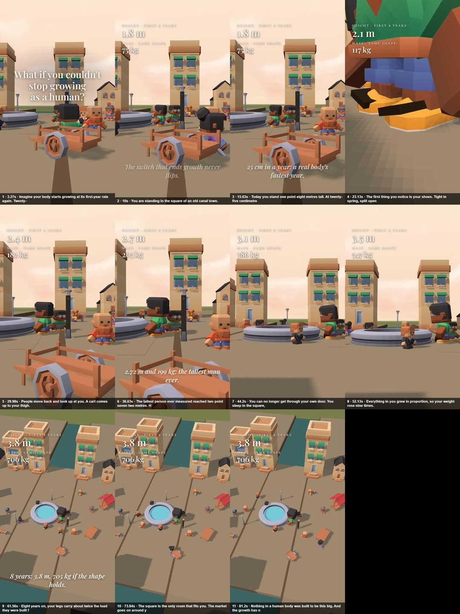

# Picture check – 2026-10-18-cant-stop-growing

_Times: estimate (no voice-times.tsv yet). Made by `node tools/whatif/scenecheck.mjs`._

✅ ALL PICTURE CHECKS PASSED

| step | s | voice | measured |
|---|---|---|---|
| 1 | 3.27 | Imagine your body starts growing at its first-year rate again. Twenty-five centimetres a year, and it never slows. | – |
| 2 | 10 | You are standing in the square of an old canal town. | you ✓ 144px square ✓ 92px |
| 3 | 15.63 | Today you stand one point eight metres tall. At twenty-five centimetres a year, eight years add two metres. | you ✓ 150px |
| 4 | 23.13 | The first thing you notice is your shoes. Tight in spring, split open by autumn. | you ✓ 1280px |
| 5 | 29.98 | People move back and look up at you. A cart comes up to your thigh. | people ✓ 142px you ✓ 225px cart ✓ 442px the cart comes up to your thigh ✓ 43% |
| 6 | 36.63 | The tallest person ever measured reached two point seven two metres. He weighed almost two hundred kilos. | people ✓ 151px |
| 7 | 44.2 | You can no longer get through your own door. You sleep in the square, beside the fountain. | you ✓ 236px door ✓ 450px square ✓ 76px fountain ✓ 110px |
| 8 | 52.13 | Everything in you grew in proportion, so your weight rose nine times. But the bone that carries it grew only four times stronger. | you ✓ 283px the fountain rim comes only to your knee ✓ 30% |
| 9 | 61.56 | Eight years on, your legs carry about twice the load they were built for. Your head is above the lanterns now. | lanterns ✓ 65px your head is above the lanterns ✓ 84% |
| 10 | 73.84 | The square is the only room that fits you. The market goes on around your legs. | square ✓ 166px you ✓ 166px market ✓ 162px |
| 11 | 81.2 | Nothing in a human body was built to be this big. And the growth has not stopped. | – |

Camera: 4 hard cuts at 21, 25, 54, 59 s
