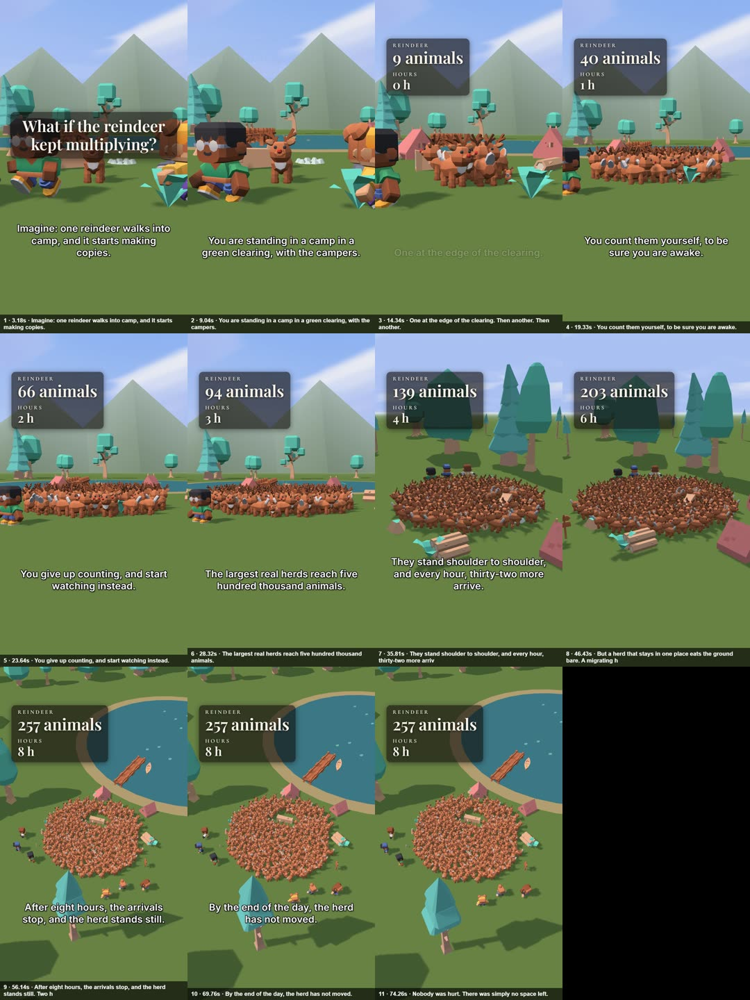

# Picture check – 2026-10-20-reindeer-multiply

_Times: voice-times.tsv. Made by `node tools/whatif/scenecheck.mjs`._

✅ ALL PICTURE CHECKS PASSED

| step | s | voice | measured |
|---|---|---|---|
| 1 | 3.18 | Imagine: one reindeer walks into camp, and it starts making copies. | reindeer ✓ 226px |
| 2 | 9.04 | You are standing in a camp in a green clearing, with the campers. | campers ✓ 373px |
| 3 | 14.34 | One at the edge of the clearing. Then another. Then another. | – |
| 4 | 19.33 | You count them yourself, to be sure you are awake. | – |
| 5 | 23.64 | You give up counting, and start watching instead. | – |
| 6 | 28.32 | The largest real herds reach five hundred thousand animals. | – |
| 7 | 35.81 | They stand shoulder to shoulder, and every hour, thirty-two more arrive. Even so, it is only a fraction of a real herd. | – |
| 8 | 46.43 | But a herd that stays in one place eats the ground bare. A migrating herd walks up to five thousand kilometres a year, eating as it goes. | – |
| 9 | 56.14 | After eight hours, the arrivals stop, and the herd stands still. Two hundred and fifty-seven reindeer surround the camp. | reindeer ✓ 464px |
| 10 | 69.76 | By the end of the day, the herd has not moved. | – |
| 11 | 74.26 | Nobody was hurt. There was simply no space left. | – |

Camera: 2 hard cuts at 33, 54 s
