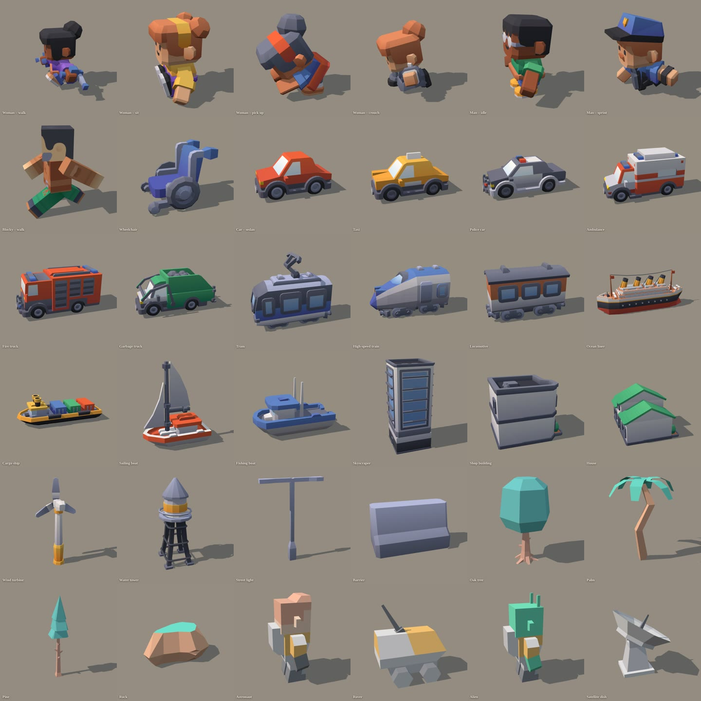

# Gratis 3D-modellen (CC0)

Alles in `assets/kenney/` komt van **Kenney** (https://kenney.nl/assets) en is **CC0**: gratis, ook voor YouTube,
zonder naamsvermelding. Per pakket staat de licentie in `License.txt`.



| Map | Pakket (bron) | Wat erin zit |
|---|---|---|
| `kenney/mini-characters/` | [Mini Characters](https://kenney.nl/assets/mini-characters) | 6 vrouwen + 6 mannen **met animaties**, rolstoelen, hulpmiddelen |
| `kenney/blocky-characters/` | [Blocky Characters](https://kenney.nl/assets/blocky-characters) | 18 blokpoppetjes met animaties |
| `kenney/car-kit/` | [Car Kit](https://kenney.nl/assets/car-kit) | sedan, suv, taxi, politie, ambulance, brandweer, vuilniswagen, busje, vrachtwagen, tractor, losse wrakstukken |
| `kenney/train-kit/` | [Train Kit](https://kenney.nl/assets/train-kit) | tram, metro, hogesnelheidstrein, locomotieven, wagons, rails |
| `kenney/watercraft-kit/` | [Watercraft Kit](https://kenney.nl/assets/watercraft-kit) | cruiseschip, vrachtschip, sleepboot, vissersboot, zeilboot, speedboten, boeien, containers |
| `kenney/city-kit-commercial/` | [City Kit Commercial](https://kenney.nl/assets/city-kit-commercial) | winkelpanden, wolkenkrabbers, luifels, parasols |
| `kenney/city-kit-suburban/` | [City Kit Suburban](https://kenney.nl/assets/city-kit-suburban) | huizen, hekken, opritten, bomen |
| `kenney/city-kit-industrial/` | [City Kit Industrial](https://kenney.nl/assets/city-kit-industrial) | fabrieken, schoorstenen, tanks, containers, zonnepanelen, windmolen, watertoren |
| `kenney/city-kit-roads/` | [City Kit Roads](https://kenney.nl/assets/city-kit-roads) | wegen, kruispunten, bruggen, lantaarns, elektriciteitspalen, bouwhekken |
| `kenney/nature-kit/` | [Nature Kit](https://kenney.nl/assets/nature-kit) | 329 stukken: bomen, palmen, dennen, rotsen, cactussen, bloemen, kampvuur, kano, kliffen |
| `kenney/space-kit/` | [Space Kit](https://kenney.nl/assets/space-kit) | astronauten, alien, rover, raketonderdelen, schotels, ruimtebasis, kraters, meteoren |

## Animaties van de poppetjes (mini-characters)
`idle, walk, sprint, jump, fall, crouch, sit, drive, die, pick-up, emote-yes, emote-no, holding-right/left/both,
interact-right/left, wheelchair-sit, wheelchair-move-*` (en een paar vecht-animaties: niet gebruiken, geen geweld).

## Gebruik in een scene.html
Importmap (paden vanuit de videomap):
```html
<script type="importmap">{ "imports": { "three": "../node_modules/three/build/three.module.js",
                                         "three/addons/": "../node_modules/three/examples/jsm/" } }</script>
```
```js
import { loadModel } from '../assets/load.js';
const woman = await loadModel('../assets/kenney/mini-characters/character-female-a.glb', { height: 1.7, anim: 'walk' });
scene.add(woman.root);                 // staat op y = 0, gecentreerd
// in renderAt(t):
woman.setTime(t);                      // animatie volgt de videotijd (elk beeld los te renderen)
woman.play('pick-up', 32.5);           // andere animatie vanaf videotijd 32.5 s
const taxi = await loadModel('../assets/kenney/car-kit/taxi.glb', { length: 4.3 });
```
`renderAt(t)` moet wachten tot de modellen geladen zijn: zet `window.ready = true` pas ná de `await loadModel(...)`.

## Let op de stijl
De poppetjes van Kenney hebben **grote hoofden** (cartoonstijl) en zijn dus anders dan de simpele figuren uit de
gravity-video. Van dichtbij valt dat op; op afstand en in een menigte past het goed. Kies per video één soort mensen
en meng ze niet door elkaar.

## Meer modellen toevoegen
1. Download een CC0-pakket (Kenney, Quaternius) en zet de `.glb`/`.gltf`-bestanden in `assets/<bron>/<pakket>/`
   met de `License.txt`.
2. Zet het in de tabel hierboven en in `showroom/showlist.json`.
3. `node assets/showroom/showroom.mjs` → nieuwe `showroom/SHOWROOM.jpg`.

Quaternius (https://quaternius.com, ook CC0, met realistischere mensen en dieren) zet zijn downloads op Google Drive.
