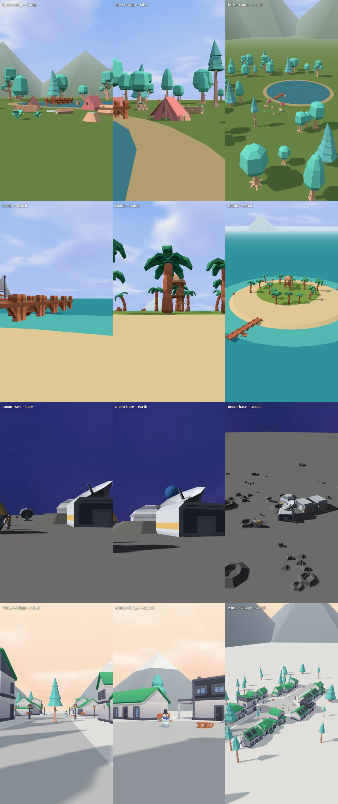

# Omgevingen (kant-en-klaar, CC0-modellen van Kenney)

Elke omgeving is één bestand dat een hele plek bouwt, met 3 camera's (ooghoogte, tweede standpunt, hoog).
Ze gebruiken de gratis modellen uit `assets/kenney/` (zie `assets/README.md`) en `assets/load.js`.



| Bestand | Plek | Camera's | Goed voor |
|---|---|---|---|
| `island.js` | tropisch eiland: zand, palmen, hut, steiger met roeiboot, zeilboot, cruiseschip aan de horizon | beach, palms, aerial | zeespiegel stijgt, tsunami, getij, hitte, storm |
| `winter-village.js` | winterdorp: huizen rond een plein, dennen, sneeuwpop, slee, lantaarns, besneeuwde bergen | street, square, aerial | kou, zon gaat uit, ijstijd, sneeuwstorm |
| `forest-camp.js` | bos met kamp bij een meer: tenten, kampvuur, boomstammen, steiger, kano, heuvels | camp, lake, aerial | dieren, bosbrand, storm, overleven, aliens |
| `moon-base.js` | maanbasis: grijze kratervlakte, hangars, schotels, rover, astronauten, de aarde aan de hemel | base, earth, aerial | ruimte, de maan, lage zwaartekracht, meteorieten |

Luchten (`assets/kenney/skyboxes/`): day, morning, night, alien, space, space-day, space-galaxy, space-nebula, space-band, space-dark.

## Gebruik in een scene.html
```js
import * as THREE from 'three';
import { loadModel } from '../assets/load.js';
import * as island from '../environments/island.js';
const info = await island.build({ THREE, scene, loadModel, base: '../assets/kenney' });
const cam = info.cameras.beach;            // { pos, look } — gebruik als begin van een shot
camera.position.set(...cam.pos); camera.lookAt(...cam.look);
window.ready = true;                       // pas na build()
```
`build()` geeft ook `groundY` (en `seaLevel` / `waterY`) terug, zodat effecten (water, sneeuw, kraters) op de goede hoogte komen.

## Nieuwe omgeving maken
1. Kopieer een bestaand bestand (bijv. `forest-camp.js`) naar `environments/<naam>.js`.
2. Gebruik de helpers uit `kit.js`: `put(ctx, pakket, model, {height|length}, [x,y,z], draaiing)`, `sky(ctx, 'day')`,
   `light(ctx)`, `plane(ctx, grootte, kleur)`, `hills(ctx, {...})`, `rng(seed)` (zelfde toeval bij elke render).
3. Zet 3 camera's in `cameras` (ooghoogte, tweede standpunt, hoog).
4. `node environments/preview.mjs <naam>` → `previews/<naam>-<camera>.jpg`; bekijk ze en verbeter.
5. Zet hem in de tabel hierboven en in LIBRARY.md.
